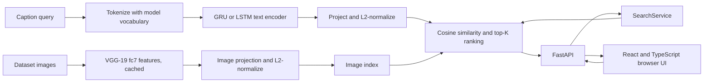

# Image Caption Retrieval

NeuralSeek is this project's text-to-image search application. Type a sentence such as *"a dog running through snow"* and the system ranks indexed images by mapping captions and images into a shared embedding space.

Course project: UE24CS352A — Machine Learning Mini-Project. Inspired by the paper *Neural Caption–Image Retrieval*
(MS-COCO, VGG-19 fc7, GloVe, GRU/LSTM, margin ranking loss, Recall@K and mean rank).

> **Honesty note.** This repository contains complete code, tests and documentation, but **no experimental
> results are included**: training on MS-COCO has to be run on your machine (see below). Every results table in
> the report, slides and web app is filled from files your own runs produce and shows **"pending"** until then.
> Numbers from the paper are shown only as clearly labelled *reference* values.

## Verification status (2026-11-19)

| Component | Status |
|---|---|
| Python test suite | **Executed**: 94 passed, 1 skipped (optional FAISS package missing) in a clean Python 3.11 virtual environment |
| Synthetic pipeline | **Executed**: shapes, baseline, GRU, LSTM, validation/test evaluation, index construction and retrieval completed; values are smoke-test-only |
| Backend | **HTTP tests executed** as part of pytest; cloud startup and deployment are not verified |
| Frontend | **Executed**: TypeScript check, 13 Vitest tests, production build |
| npm dependency audit | **Executed** after frontend tooling updates; 0 reported vulnerabilities |
| Real MS-COCO/GloVe experiments, VGG-19 extraction, cloud deployment | **Not run** |

Pytest uses `.pytest-tmp/` under the repository to avoid Windows temp-directory permission errors. The Python 3.11 run is within the documented support range; CI targets Python 3.12. Synthetic results are not real-data experiment results.

## Features

- Reproducible dataset pipeline: Karpathy split loader, validation of missing/corrupt/duplicate images, leakage check, train-only vocabulary, labelled subsets, dataset statistics.
- Three models with one shared evaluation path: **linear-regression baseline**, **GRU + GloVe**, **LSTM + GloVe** (plus a random-init GRU ablation config).
- Bidirectional margin ranking loss, early stopping on a validation metric, best/last checkpoints, resumable training.
- Metrics in both directions: Recall@1/5/10, mean and median rank (`full` and `1k` protocols), pessimistic tie handling.
- Retrieval index (exact cosine search; FAISS optional) with image-id → file integrity checks.
- FastAPI backend with validated requests, consistent errors and safe image serving.
- React + TypeScript + Tailwind UI: Search, Models, Evaluation, About.
- Synthetic smoke-test mode (no download) so everything can be exercised in minutes.

## Project objectives

- Retrieve images from a natural-language caption by comparing image and text representations in a shared embedding space.
- Implement and compare a linear-regression baseline with GRU and LSTM text encoders using the same evaluation pipeline.
- Make the data preparation, training, evaluation and retrieval steps reproducible, while keeping test-set evaluation separate from model selection.
- Provide a browser interface and API for searching available indexed images and inspecting model and evaluation metadata.

These objectives describe the code in this repository. Real MS-COCO experiments still need to be run locally; the pending-results and verification notes below distinguish software smoke checks from research results.

## Architecture



During training, matching image-caption pairs are pulled together and mismatched pairs separated with a margin ranking loss. The linear-regression baseline instead predicts image features from mean word vectors. The browser search path uses the selected retriever and its prebuilt image index.

Details: [docs/architecture.md](docs/architecture.md), [docs/methodology.md](docs/methodology.md).

## Repository layout

```
configs/      baseline.yaml  gru.yaml  lstm.yaml  gru_no_glove.yaml
scripts/      download_data  prepare_data  extract_features  train  evaluate  build_index
              smoke_test  make_report_assets  build_report  build_slides
src/          data/ models/ training/ evaluation/ retrieval/ utils/   (the ML library)
backend/      FastAPI app (main.py, schemas.py, config.py, services/)
frontend/     React + Vite + TypeScript + Tailwind
tests/        pytest suites (data, models, retrieval, api) ; frontend/src/test (Vitest)
docs/         architecture, methodology, troubleshooting, traceability, viva_qa, demo_script, submission_checklist
reports/      final_report.md (+ PDF), metrics/ and figures/ (generated from real runs)
presentation/ slides_outline.md (+ generated .pptx)
data/         README.md, raw/ and processed/ (git-ignored)    artifacts/  checkpoints + indexes (git-ignored)
```

## Windows 11 setup (PowerShell)

```powershell
# 1. Install tools (once). Close and reopen PowerShell afterwards.
winget install -e --id Python.Python.3.11
winget install -e --id OpenJS.NodeJS.LTS
winget install -e --id Git.Git

# 2. Get the code and create a virtual environment
cd $HOME\Documents
git clone https://github.com/mutturaj-angadi/Image-Caption-Retrieval.git
cd Image-Caption-Retrieval
py -3.11 -m venv .venv
.\.venv\Scripts\Activate.ps1          # if blocked: Set-ExecutionPolicy -Scope CurrentUser RemoteSigned
python -m pip install --upgrade pip

# 3. If you have an NVIDIA GPU, select a matching PyTorch build first:
#    https://pytorch.org/get-started/locally/

# 4. Install the project
pip install -r requirements.lock.txt
pip install -r requirements-optional.txt     # optional: FAISS; ignore errors if no wheel exists for your Python
Copy-Item .env.example .env                  # optional configuration
cd frontend
npm ci                                       # install the locked frontend dependencies
cd ..
```

The frontend uses Node.js 20.19+ or 22.12+ (Vite 8 requirement). CPU-only is fine for the baseline, for training on cached features and for the web app. The only slow step on CPU is
VGG-19 feature extraction, so use a subset (below) or a GPU/Colab for it.

### Unix-like setup (Linux/macOS)

```sh
python3.11 -m venv .venv
source .venv/bin/activate
python -m pip install --upgrade pip
pip install -r requirements.lock.txt
# For an NVIDIA GPU, install the matching torch/torchvision build from https://pytorch.org/get-started/locally/ first.
cd frontend
npm ci
```

Start the backend from the repository root with `uvicorn backend.main:app --host 0.0.0.0 --port 8000`; start the frontend in another terminal with `cd frontend && npm run dev`.

### Route A — quick start (≈ 5 minutes, no downloads)

```powershell
python scripts/smoke_test.py --write-env       # builds a synthetic demo workspace in data/smoke and prints a summary
python -m pytest -q                            # FAISS test skips if faiss-cpu is not installed
uvicorn backend.main:app --port 8000           # terminal 1 (API docs: http://localhost:8000/docs)
cd frontend; npm ci; npm run dev               # terminal 2 -> open http://localhost:5173
```

Expected: the app shows a yellow *synthetic data* banner. Searching *"a red circle on a white background"* returns shapes.
Delete `.env` to return to the real data locations.

### Route B — real experiment on MS-COCO

```powershell
python scripts/download_data.py --what karpathy glove annotations     # ~1.2 GB; see data/README.md for manual placement
python scripts/download_data.py --what images                         # ~19 GB (train2014 + val2014)

# Development subset (clearly labelled as such in metadata, report and UI) -- recommended on limited hardware:
python scripts/prepare_data.py --source karpathy --max-train 20000 --max-val 1000 --max-test 1000
# Full historical split (113,287 / 5,000 / 5,000):
#   python scripts/prepare_data.py --source karpathy

python scripts/extract_features.py --batch-size 16          # lower the batch size if you run out of memory / VRAM

python scripts/train.py --config configs/baseline.yaml
python scripts/train.py --config configs/gru.yaml
python scripts/train.py --config configs/lstm.yaml
python scripts/train.py --config configs/gru_no_glove.yaml  # ablation (optional)
# add  --set train.epochs=10 --set train.batch_size=64  to shorten runs; --resume to continue

# Validation numbers while tuning; TEST only once, when the configuration is final:
python scripts/evaluate.py --config configs/gru.yaml --split val
foreach ($c in "baseline","gru","lstm") { python scripts/evaluate.py --config configs/$c.yaml --split test --allow-test }
foreach ($c in "gru","lstm","baseline") { python scripts/build_index.py --config configs/$c.yaml }
python scripts/make_report_assets.py          # figures + comparison table from the real result files
python scripts/build_report.py                # reports/final_report.pdf
python scripts/build_slides.py                # presentation/NeuralSeek.pptx

uvicorn backend.main:app --host 0.0.0.0 --port 8000
cd frontend; npm ci; npm run dev
```

On a 1 000-image test subset use `--protocol 1k`; on the full 5 000-image test set use `--protocol full` (all test
images as candidates) and/or `1k` (average of five 1 000-image folds, the common COCO convention). State which one you report.

### Configuration

All hyper-parameters live in `configs/*.yaml` (embedding size 1024, margin 0.2, Adam, lr 2e-4, early-stopping patience 5, …).
Override any value on the command line with `--set section.key=value`. Environment variables are listed in `.env.example`.

## API examples

```powershell
# (In Windows PowerShell `curl` is an alias of Invoke-WebRequest, so use Invoke-RestMethod or curl.exe.)
Invoke-RestMethod http://localhost:8000/health
Invoke-RestMethod http://localhost:8000/api/models
Invoke-RestMethod -Method Post -Uri http://localhost:8000/api/search -ContentType "application/json" `
    -Body '{"query": "a dog running through snow", "top_k": 5}'
```

`/health` returns HTTP 200 only when a usable model and index are loaded; it returns 503 with `status: degraded` otherwise. Errors always look like `{"error": {"code": "invalid_query", "message": "...", "details": null}}`.
Scores are **cosine similarities used for ranking, not probabilities**.

| Endpoint | Purpose |
|---|---|
| `GET /health` | status, number of usable models, startup warnings |
| `GET /api/models` | models with architecture, checkpoint hash, recorded evaluations |
| `GET /api/stats` | dataset statistics and indexed image counts |
| `GET /api/evaluation` | measured metrics + loss curves (`available=false` until you run experiments) |
| `POST /api/search` | `{query, top_k, model?}` → ranked images with scores and captions |
| `GET /api/images/{image_id}` | image bytes (only ids present in the dataset metadata resolve) |

## Results

| Model | T2I R@1 | T2I R@5 | T2I R@10 | T2I mean rank | I2T R@1 | I2T R@10 | Train time (s) | Latency (ms) |
|---|---|---|---|---|---|---|---|---|
| Linear regression baseline | pending | pending | pending | pending | pending | pending | pending | pending |
| GRU (random init) | pending | pending | pending | pending | pending | pending | pending | pending |
| GRU + GloVe | pending | pending | pending | pending | pending | pending | pending | pending |
| LSTM + GloVe | pending | pending | pending | pending | pending | pending | pending | pending |

*Replace with the output of `python scripts/make_report_assets.py` (`reports/metrics/summary.md`) after running Route B.
Reference only: the paper reports GRU + GloVe Recall@1 = 37.0 % and Recall@10 = 86.8 % under its own setup; this
project does not claim to reproduce those numbers (different features/weights, optimiser, protocol details).*

## Screenshots

Add screenshots of the Search, Models and Evaluation pages here after running the app (`docs/images/`). None are included because none have been captured yet.

## Limitations

Only indexed images can be returned; no attention or multi-sentence context; out-of-vocabulary words are ignored;
counting/negation/spatial relations are weak; COCO biases carry over; CLIP-style comparison is not implemented
(optional extension); torchvision VGG-19 weights differ from the paper's original Caffe model.

## Troubleshooting

See [docs/troubleshooting.md](docs/troubleshooting.md).

## Audit, CI and deployment

- Repository findings and verification limits: [docs/project_audit.md](docs/project_audit.md).
- Exact commands, outputs, skips, and unrun checks: [docs/verification_report.md](docs/verification_report.md).
- Deployment steps for a Vercel static frontend and Render backend: [docs/deployment.md](docs/deployment.md).
- CI checks Python tests and frontend types, tests, and production build without downloading datasets or requiring a GPU.

## Application workflow

1. Prepare the dataset metadata and vocabulary, then extract/cache image features (or use the synthetic smoke workspace).
2. Train a baseline or neural model, evaluate it, and build that model's retrieval index. These steps create files under `artifacts/`, `data/processed/` and `reports/`.
3. Start the FastAPI backend and Vite development server in separate terminals. The Vite server proxies `/api` and `/health` requests to the backend by default.
4. On the Search page, enter a caption and choose a model and result count. The API encodes the query, ranks indexed images by cosine similarity, and returns image ids, available captions and scores. Scores are ranking similarities, not probabilities.
5. The Models and Evaluation pages display metadata and recorded evaluation results when present. The synthetic quick-start is visibly labelled and is for pipeline checks only.

## Future enhancements

- Add a separately labelled pretrained CLIP retriever for comparison with the project models.
- Improve handling of negation, object counts, spatial relations and longer context in text queries.
- Add larger-scale approximate indexing and production deployment controls such as authentication and rate limiting.
- Capture and document representative application screenshots after running the app with a prepared dataset.

These are possible extensions; they are not implemented features.

## Team

The About page reads team entries from `frontend/src/team.ts`. The repository currently names **Mutturaj Angadi**; the remaining team fields are placeholders to be completed by the project team. Keep contributor names and details in sync with `reports/final_report.md` when completing them.

## References and licensing

See [NOTICE.md](NOTICE.md) for dataset / model licences and the reference list in the report.
Choose a code licence for the repository before making it public.
